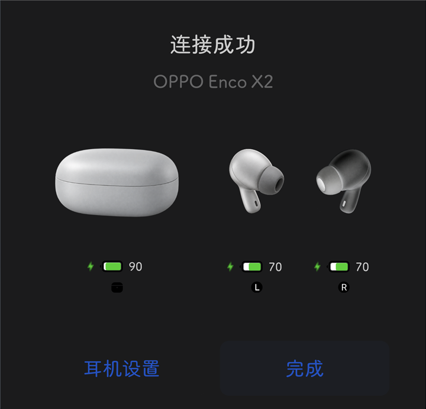
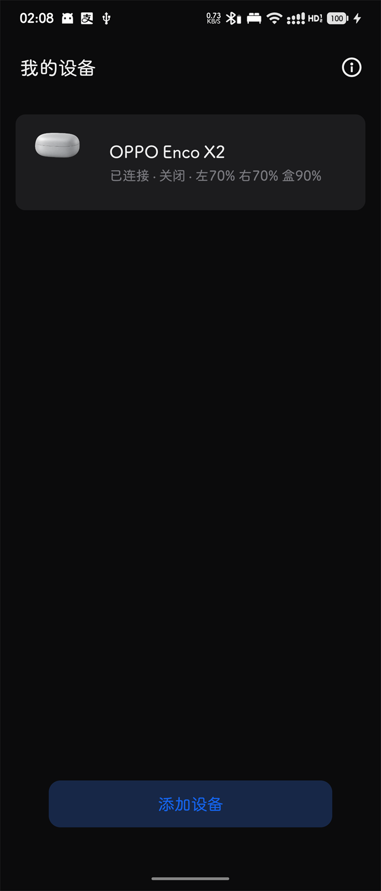
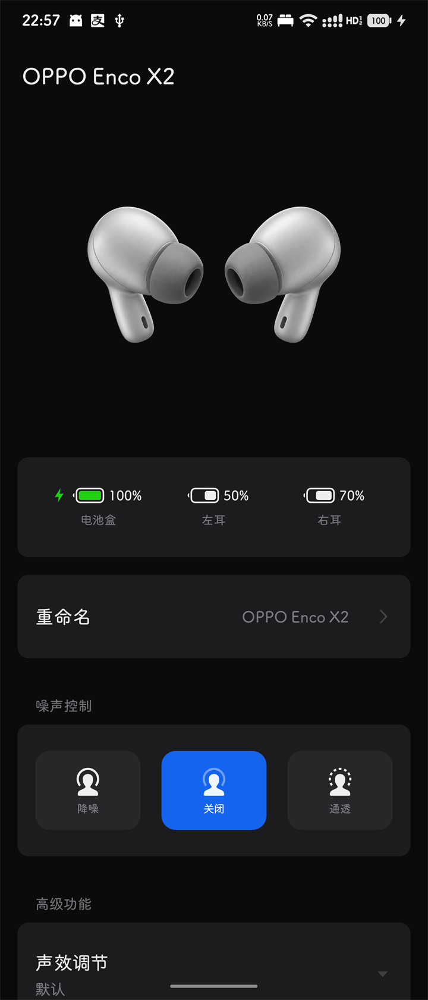

# FlymeEars

**让第三方蓝牙耳机在 Flyme 上获得魅族耳机的系统级体验。**

<p>
  
  
  
  
</p>

FlymeEars 是一个 LSPosed 模块：它通过耳机私有 RFCOMM 协议读取 OPPO Enco 系列耳机的状态（电量、降噪、佩戴、编码、双连），再包装成魅族耳机 SDK 的数据，让连接弹窗、设备列表、详情页和控制中心卡片按原生逻辑工作。模块不重绘界面，也不依赖 OPPO「欢律」。

> **非官方项目**，与魅族、OPPO 无隶属关系。模块会注入 SystemUI 与魅族耳机 App，属于系统级改动，安装前请阅读[免责声明](#免责声明)。
>
> 当前版本 **1.0.0**（2026-10-31），仅 **OPPO Enco X2** 实机验证。验证环境：魅族 21 Pro（Flyme 12.6 / Android 16）+ OPPO Enco X2（固件 154.154.120）。

**适用**：已 root 并安装 LSPosed 的 Flyme 用户，使用 OPPO Enco 系列耳机。

**不适用**：非 Flyme 系统、未 root，或想要通用蓝牙增强工具的用户。

<p align="center">
  
  
  
</p>

## 目录

- [功能](#功能)
- [兼容性](#兼容性)
- [能力与协议](#能力与协议)
- [安装](#安装)
- [已知限制](#已知限制)
- [常见问题](#常见问题)
- [工作原理](#工作原理)
- [构建](#构建)
- [致谢](#致谢)
- [许可](#许可)
- [免责声明](#免责声明)

## 功能

### 连接与展示

- **连接弹窗**：耳机连上时拉起原生弹窗，显示名称、配图、左右耳与充电盒电量。
- **设备列表**：第三方耳机出现在「我的设备」，行内显示连接状态、降噪模式与电量。
- **设备详情**：原生页面展示电量（含充电状态）、降噪三态与四档、高级功能入口。
- **设备中心**：控制中心耳机卡片显示图标、电量、降噪与连接状态。
- **添加设备**：原生扫描页可发现耳机，点「连接」走原生配对流程。

### 控制

- **降噪**：关闭 / 降噪 / 通透三态，智能 / 深度 / 均衡 / 轻度四档。
- **设备双连**：原生「设备双连」页开关下发命令，页面列出耳机记录的两台设备，状态跟随耳机重启 / 回连保留。
- **重命名**：详情页重命名，App 侧持久化。
- **低延迟**：游戏模式开关；原生提示需要系统编码为 SBC。
- **佩戴 / 在盒检测**：状态驱动的提示与弹窗。

### 音频

- **高品质音频**：AAC / LHDC / LDAC 三行，勾选态由耳机回读。
- **Hi-Res**：LHDC 下的 Hi-Res 开关。
- **预设 EQ**：声效调节里的原生预设。
- **自定义 EQ**：10 段滑杆映射到耳机 6 段 × 双声道补偿曲线。

### 系统集成

- **零重绘**：所有界面由魅族耳机 App 自己渲染，模块只提供数据。
- **无厂商 App**：不依赖「欢律」，通过 RFCOMM 直连耳机。
- **原生回调**：状态经魅族 SDK 的回调链回传，页面刷新、断开弹窗等行为与真机一致。

## 兼容性

### 环境

| 项目 | 要求 / 已验证 |
|---|---|
| 系统 | Flyme；实机验证 Flyme 12.6 / Android 16（APK `minSdk 31`） |
| 机型 | 魅族 21 Pro；其他机型未验证 |
| 框架 | LSPosed（libxposed API 102） |
| 模块版本 | 1.0.0（`versionCode 10000`） |

### 耳机

| 耳机 | 状态 | 说明 |
|---|---|---|
| OPPO Enco X2 | ✅ 实机验证 | 固件 154.154.120 |
| 其他 OPPO Enco 型号 | 🧪 按型号映射 | 未逐一验证 |
| 其他品牌 | ❌ 不支持 | 协议不同，模块按 OPPO / Enco 名称匹配 |

## 能力与协议

以下能力以 OPPO Enco X2 为准；协议列为耳机侧 opcode，`0x84xx` 是 ACK，设置是否生效以回读为准。

| 能力 | 原生入口 | 协议 | 状态 |
|---|---|---|---|
| 连接弹窗（名称 / 配图 / 电量） | 连接耳机时自动弹出 | `0x0106` + 私有握手 | ✅ |
| 设备列表（行内电量 / 降噪） | 耳机 App → 我的设备 | — | ✅ |
| 详情页电量（左 / 右 / 盒 + 充电） | 设备详情 → 电量卡片 | `0x8106` | ✅ |
| 降噪三态（关闭 / 降噪 / 通透） | 详情页 → 噪声控制 | `0x0404` / `0x810C` | ✅ |
| 降噪四档（智能 / 深度 / 均衡 / 轻度） | 详情页 → 降噪方式 | `0x0404`（档位） | ✅ |
| 预设 EQ | 详情页 → 声效调节 | `0x0406` / `0x010F` | ✅ |
| 自定义 EQ（10 段） | 声效调节 → 自定义 | `0x0411` + `0x040E` + `0x0116` / `0x0415` | 🧪 近似映射 |
| 高品质音频（AAC / LHDC / LDAC，含 Hi-Res） | 详情页 → 高品质音频 | `0x041A` / `0x0114` | ✅ |
| 低延迟（游戏模式） | 详情页 → 低延迟模式 | `0x0403`（`06`） | ✅ |
| 设备双连 | 详情页 → 设备双连 | `0x0403`（`11`）+ `0x0112` | ✅ |
| 佩戴 / 在盒检测 | 状态驱动（提示 / 弹窗） | `0x0109` / `0x0204` | ✅ |
| 重命名 | 详情页 → 重命名 | —（App 侧持久化） | ✅ |
| 设备中心卡片 | 控制中心耳机卡片 | —（宿主 Binder 回调） | ✅ |
| 查找耳机 | 暂无 UI 入口 | `0x0400` | ⬜ 协议已验证 |

> ✅ 实机验证　🧪 部分验证 / 近似　⬜ 未接 UI

## 安装

### 前置条件

- 已 root（Magisk / KernelSU / APatch 等），安装并启用 LSPosed。
- Flyme 系统（实机验证 Flyme 12.6 / Android 16），魅族耳机 App 已安装。
- 耳机已在系统蓝牙里完成配对。

### 步骤

1. 从 [Releases](https://github.com/cnnceart/FlymeEars/releases) 下载 `FlymeEars-1.0.0.apk` 并安装。
2. 打开 LSPosed → 模块 → 启用 **FlymeEars**。
3. 勾选作用域：`com.android.systemui`、`com.meizu.earphone`、`com.meizu.connectivitysettings`。
4. 重启手机。

### 验证是否生效

- 打开魅族耳机 App，设备列表出现耳机，行内带电量与降噪状态。
- 连接耳机，系统弹出原生连接弹窗。
- 进入详情页，电量、噪声控制、声效调节可用。

### 升级与卸载

- **升级**：覆盖安装新版本 APK，然后重启手机。
- **卸载**：在 LSPosed 中停用模块 → 卸载 APK → 重启手机。

## 已知限制

- 仅 Enco X2 实机验证；其他 OPPO Enco 型号按型号映射处理，未逐一验证。
- 自定义 EQ 走耳机的 6 段听力补偿曲线，10 段滑杆按频段折叠，属近似映射。
- 充电状态：耳机在盒内不置 bit7，模块按「在盒 = 充电」推断；进盒瞬间可能有 2–3 秒延迟（RFCOMM 重连）。
- 降噪切换需要佩戴耳机；未佩戴时原生页面会提示并回滚。
- 切换编码、开启设备双连会触发耳机重启或蓝牙重连，页面短暂不可用属正常现象。
- 宿主 App 或系统更新可能改变内部方法签名，导致 hook 失效，需要等待模块适配。

## 常见问题

**装完没有效果？**
检查 LSPosed 中模块是否启用、三个作用域是否全部勾选、安装后是否重启；再看 LSPosed 日志里有没有 `FlymeEars` 的输出。

**耳机连上了但没有弹窗？**
模块按名称匹配 OPPO / Enco 设备，确认耳机名称没有被改掉；首次连接后稍等几秒。

**重启手机后失效？**
确认 LSPosed 能开机自启；部分系统优化会阻止模块加载。重新勾选作用域并重启。

**系统或耳机 App 更新后失效？**
hook 依赖宿主内部实现，更新可能改变方法签名。请附上版本号提 issue。

**会不会影响其他蓝牙设备？**
不会。模块只处理名称匹配 OPPO / Enco 的设备，不修改蓝牙栈。

**低延迟开关是灰的？**
原生页面要求系统编码为 SBC；先在蓝牙设置里切换编码。

**怎么反馈问题？**
附机型、Flyme 版本、耳机型号与固件、模块版本，以及 LSPosed 日志；不要贴隐私数据。

## 工作原理

模块注入三个进程：SystemUI 持有 RFCOMM 链路，负责连接信号、状态广播与原生弹窗；魅族耳机 App 接收状态，并通过魅族 SDK 的回调刷新页面；`connectivitysettings`（可选）用于系统设置里的设备卡片。蓝牙栈本身不改。

状态回传走魅族 SDK 自己的回调链，而不是去调用页面方法：

```text
耳机帧 -> EncoLink 解析 -> EncoSession 广播 -> ModuleState
        -> MzBluetoothWrapper 的 SDK 回调对象（写状态模型 + 通知 LiveData）
        -> BluetoothConnectionCallbackHandler（连接 / 降噪 / 佩戴事件）
        -> 原生页面按自己的逻辑刷新
```

所以页面刷新、断开弹窗、高品质页勾选等行为都与真机一致；模块不重绘任何原生界面。

## 构建

需要 JDK 17、Android SDK 37（`platforms;android-37.0`）；Gradle 9.6.0 由 wrapper 提供。先在 `local.properties` 里配置 `sdk.dir`。

```powershell
.\gradlew.bat testDebugUnitTest assembleDebug
```

产物位于 `app/build/outputs/apk/debug/app-debug.apk`。

release 构建（`assembleRelease`）沿用 debug 签名，便于直接覆盖安装；版本号在 `app/build.gradle.kts` 的 `versionCode` / `versionName`。

## 致谢

- [HyperEars](https://github.com/silverpoetry/HyperEars)（GPL-3.0-only）—— OPPO Enco 私有协议实现与耳机渲染素材；本项目的协议层移植自它
- [flyme-mod](https://github.com/rikumi/flyme-mod)（MIT）—— 魅族耳机 SDK 的 Binder 通道用法参考
- [MelodyCodecTweaker](https://github.com/Andrea-lyz/MelodyCodecTweaker)（Apache-2.0）—— 宿主注入与诊断结构参考
- [LSPosed](https://github.com/LSPosed/LSPosed) / libxposed（Apache-2.0）—— 模块框架

完整出处与许可说明见 [THIRD_PARTY_NOTICES.md](THIRD_PARTY_NOTICES.md)。

## 许可

Copyright (C) 2026 cnnceart

本项目以 **GPL-3.0-only** 发布，完整条款见 [LICENSE](LICENSE)。协议层移植自 HyperEars（GPL-3.0-only），因此本项目作为衍生作品同样只能按 GPL-3.0-only 分发，而非「GPL-3.0 或更高版本」。

## 免责声明

- 本项目为非官方项目，与魅族、OPPO 及其关联公司无隶属关系，也未获其授权；相关商标与产品名称归各自权利人所有。
- 模块通过 Hook 注入系统进程，可能导致系统不稳定、耳机异常或数据丢失，请自行评估风险。
- 因使用本项目产生的任何直接或间接损失，作者不承担责任。
- 安装前请确认了解如何停用 LSPosed 模块或进入 Recovery，并备份重要数据。
