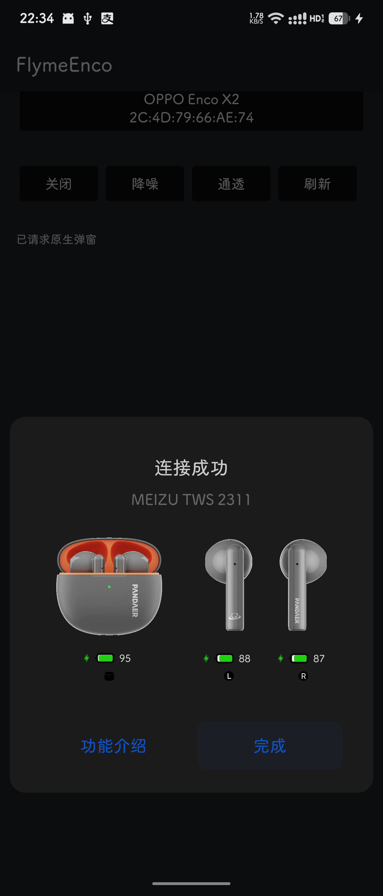
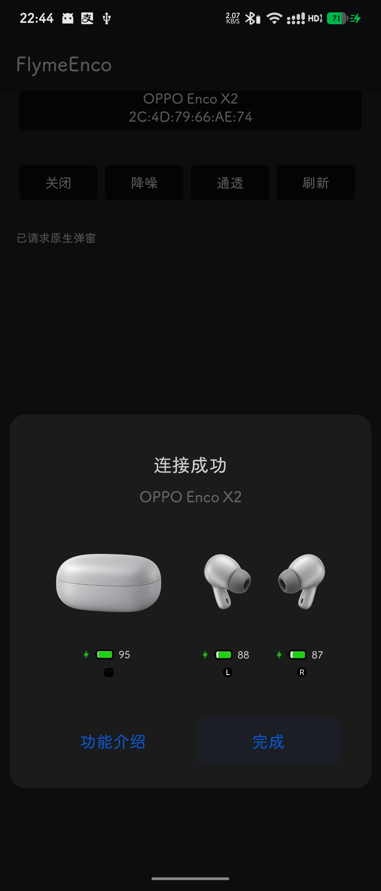
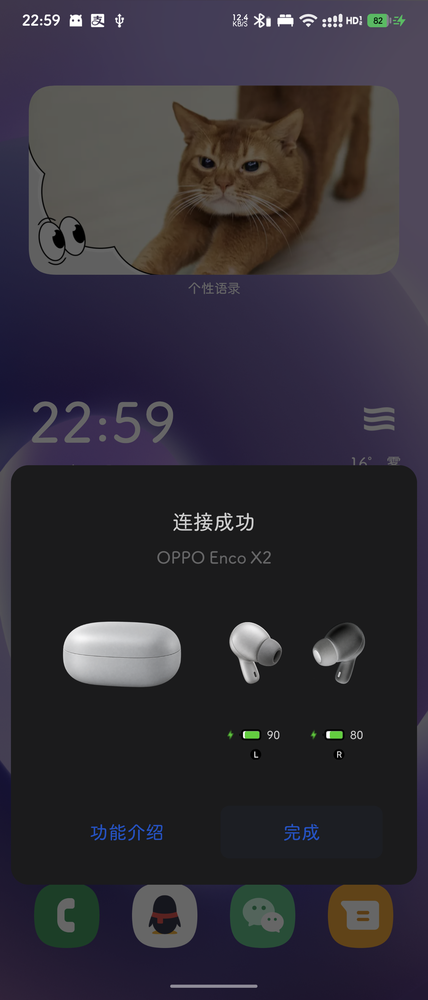

# Flyme 耳机组件逆向记录

设备：MEIZU 21 Pro，Flyme 12.6.0.0A，Android 16（SDK 36）。
样本：

| 包 | 版本 | 路径 |
|---|---|---|
| `com.meizu.earphone` | 100.12.23 | `/system/app/TWS/TWS.apk` |
| `com.android.systemui` | 16.26.06.25_base | `/system_ext/priv-app/SystemUI/SystemUI.apk` |
| `com.meizu.connectivitysettings` | 12.15.000 | `/system_ext/priv-app/ConnectivitySettings/ConnectivitySettings.apk` |
| `com.heytap.headset`（欢律） | 117.6.6 | `/data/app/.../base.apk` |

## 连接弹窗链路

```text
MzBluetoothService            （com.meizu.earphone，Service）
  └─ Handler MSG_MODEL_INFO_SUCCESS (what=4)
       └─ startMzfpDialogActivity(MzfpDevice, MzfpModelInfoBean, network, connected)
            └─ Intent → MzfpDailogActivity        （exported，无权限校验）
                 └─ MzfpBluetoothDialogFragment     （DialogFragment）
                      ├─ IS_CONNECTED=true  → MzfpDeviceConnectedFragment
                      └─ IS_CONNECTED=false → MzfpDeviceFoundFragment
```

### Intent 契约

| key | 类型 | 说明 |
|---|---|---|
| `DIALOG_TYPE_KEY` | int | 1 = 蓝牙；0 会直接 finish |
| `MZFP_DEVICE_KEY` | `MzfpDevice` | 设备与电量，**必填**，为空直接 finish |
| `NETWORK_ENABLE` | boolean | true 时用 `DIALOG_MODEL_INFO` 的名称与网络图 |
| `IS_CONNECTED` | boolean | 决定显示"已连接"还是"发现设备"子页 |
| `DIALOG_MODEL_INFO` | `MzfpModelInfoBean` | 仅 `NETWORK_ENABLE=true` 时使用 |

### 关键结论

1. **电量由传入的 `MzfpDevice` 决定**，不查 SDK：
   `MzfpDeviceConnectedFragment.onViewCreated` 直接读
   `getBoxBattery() / getLeftBattery() / getRightBattery()`，按 `value & 0x7F` 截断到 0..100。
   因此外部构造 `MzfpDevice` 即可显示任意电量。
2. **名称为硬编码**：`NETWORK_ENABLE=false` 时名称来自资源
   （`MEIZU TWS 2311`），配图固定 `R.drawable.tws_2311`（魅族 PANDAER 图），
   且**不会给 `nameTextView` 赋值**。
3. 弹窗是底部 gravity 的对话框（`FLAG_ALT_FOCUSABLE_IM`，dimAmount=0），
   `onDismiss` 会 `finish()` 自己。
4. `MzfpDevice` 是标准 Parcelable，字段全部有 public setter；
   外部可用 `createPackageContext("com.meizu.earphone", CONTEXT_INCLUDE_CODE)`
   借宿主 ClassLoader 构造实例后通过 `putExtra` 传给弹窗。

## 已实测

外部构造 `MzfpDevice`（电量 88/87/95）并 `startActivity`，
原生弹窗成功渲染，电量与注入值一致：



日志：

```text
FlymeEnco: popup: 已唤起原生弹窗 2C:4D:79:66:AE:74
MzfpDailogActivity: handleIntent device id: 2C:4D:79:66:AE:74
MzfpDailogActivity: DIALOG_TYPE_BLUETOOTH
MzfpBluetoothDialogFragment: onViewCreated
```

进一步走 `NETWORK_ENABLE=true` 路径（`MzfpModelInfoBean` + `content://` 配图），
并在宿主进程 Hook 替换左右单耳后，弹窗完整呈现为：



- 名称：`OPPO Enco X2`（来自 `ModelData.modelName`）
- 充电盒：模块 `ArtProvider` 提供的 `content://dev.flymeenco.art/enco_case.png`
- 左右单耳：`EarphonePopupHooks` 替换 `iv_tws_left` / `iv_tws_right`
- 电量：95 / 88 / 87（注入值）

### 布局结构（`mzfp_device_connected_fragment.xml`）

| id | 尺寸 | 原本 |
|---|---|---|
| `iv_tws_box` | 108×108 | `ic_tws_box`（魅族充电盒） |
| `iv_tws_left` | 48×105 | `ic_tws_left`（魅族左耳） |
| `iv_tws_right` | 48×105 | `ic_tws_right`（魅族右耳） |

### 坑

- 宿主 `com.meizu.earphone` 进程没有 `BLUETOOTH_CONNECT`，
  Hook 里调用 `BluetoothDevice.getName()` 会抛 `SecurityException` 并打断弹窗初始化。
  名称必须由 `ModelInfoBean` 提供，Hook 只做配图。
- 更新模块 APK 后需要重启作用域进程（`am force-stop com.meizu.earphone`）才会加载新代码。

## 降噪控制（真机已验证）

控制链路：

```text
「降噪」快捷磁贴 --broadcast--> SystemUI EncoSession --RFCOMM--> 耳机
        ^                                   |
        +----------- 模式变化广播 -----------+
```

实测（耳机佩戴状态）：

```text
session: 磁贴触发模式切换
link: 已下发模式 降噪
link: 帧 cmd=0x8404 payload=00
link: 降噪模式：降噪
```

`0x8404 00` = 成功；耳机在充电盒中会返回 `0x0E`（无法开启 ANC），
模块会打印"耳机拒绝切换，常见原因：在充电盒中或未佩戴"。

## 自动触发（已跑通）

SystemUI 进程内的 `EncoSession` 监听音频输出设备，命中 OPPO/Enco 后自建 RFCOMM，
拿到第一份电量就拉起弹窗；耳机断开即释放。实测链路：

```text
session: 连接 OPPO Enco X2（2C:4D:79:66:AE:74）
session: 通过 SDP UUID 建链
session: RFCOMM 已连接
session: 特性上报 ID：01 02 03 04 08 0B F1 F2 F3
session: 拉起原生弹窗 90/80/-1
popup: 已唤起原生弹窗
```

耳机在耳时充电盒不上报电量，`-1` 会让原生视图保留默认的 "100"，
因此 `EarphonePopupHooks` 会把对应的行与图标设为 `INVISIBLE`。



## 待解决

| 项 | 方案 | 状态 |
|---|---|---|
| 名称显示为 MEIZU TWS 2311 | 走 `NETWORK_ENABLE=true` + `ModelData.modelName` | ✅ 已验证 |
| 配图为魅族 PANDAER | 充电盒走 `content://` 配图；左右单耳由 Hook 替换 | ✅ 已验证 |
| 自动触发 | SystemUI 侧监听 A2DP 连接 + 直连读电量后再拉起 | 待实现 |
| 音量面板降噪图标 | 参考 flyme-mod 的 `QSVolumeControllerImpl` 注入点 | 待实现 |
| 设备卡片电量 | `com.meizu.connectivitysettings` 待逆向 | 待实现 |

## OPPO Enco X2 实测协议

设备 `OPPO Enco X2`（`2C:4D:79:66:AE:74`），通过私有 RFCOMM
（UUID `0000079a-d102-11e1-9b23-00025b00a5a5`，实测服务通道 scn=15）验证。

| 用途 | 请求 | 响应 |
|---|---|---|
| 电量 | `0x0106` | `0x8106` payload `00 02 01 5A 02 5A`（组件, 值）|
| 查模式 | `0x010C` payload `01 01` | `0x810C` payload `00 01 01 <p> <s>` |
| 设模式 | `0x0404` payload `01 01 <p>` | `0x8404` payload `00` = 成功 |
| 特性查询 | `0x0200` | `0x8200` → ID `01 02 03 04 08 0B F1 F2 F3` |
| 注册上报 | `0x0205` payload `05 <ids>` | — |
| 主动上报 | — | `0x0204` payload `03 <type> 01 <value> 00` |

电量组件：`0x01` 左、`0x02` 右、`0x03` 仓；低 7 位是百分比，`0x80` 是充电位。
耳机在耳时只报左右耳（仓缺失）。

### ANC 取值（实测三态互通）

| 模式 | 写入 primary | 回读 primary/secondary |
|---|---|---|
| 降噪 | `0x02` | `0x80`（另有 `0x10/0x20/0x40` 强度档）|
| 关闭 | `0x01` | `0x08` |
| 通透 | `0x04` | `0x00` + secondary `0x02` |

结论：X2 使用**标准映射**（`OppoWireConfig.STANDARD`），与 HyperEars 的 Air2 Pro
例外相反。三种模式写入均返回 `0x8404 00` 并可从 `0x810C` 正确回读。

### 与欢律的互斥

欢律（`com.heytap.headset`）运行时会占用该 RFCOMM 通道，此时 SDP 与固定通道
均失败（`bt socket closed`）。`pm disable-user --user 0 com.heytap.headset` 后
SDP 建链立即成功，说明**同一时刻只能有一个私有通道客户端**。

## Flyme 原生设备中心（耳机空间）

Flyme 有系统级「设备中心」，实现位于 SystemUI：

| 类 | 作用 |
|---|---|
| `com.flyme.systemui.controls.DeviceCenterController` | 枚举 provider、白名单过滤、订阅收藏 |
| `com.flyme.systemui.controls.data.repository.DeviceCenterRepository` | `ControlKey -> MzControlInfo` |
| `com.flyme.systemui.qs.tileimpl.DeviceCenterQSTileViewImpl` | 控制中心磁贴 |
| `com.flyme.dck.service`（独立包） | 设备中心后端服务 |

它基于 **Android 标准 Device Controls**（`android.service.controls`）：
`com.meizu.earphone` 的 `TWSControlService extends ControlsProviderService`
就是魅族耳机往设备中心发布卡片的方式。

### 白名单

`DeviceCenterController.filterServicesByWhitelist()` 只放行：

1. 系统应用（`ApplicationInfo.flags & (FLAG_SYSTEM|FLAG_UPDATED_SYSTEM_APP)`）；
2. `R.array.config_controlsWhitelistPackages` 中配置的包。

普通应用的 `ControlsProviderService` 会被过滤掉。该数组编译在 SystemUI 资源里，
无法通过设置项修改，因此**需要 Hook `isServiceInWhitelist` 放行本模块**
（模块已注入 SystemUI，成本极低）。

### 结论

要用「原生耳机空间」而不是自建 App，路线是：

1. 本模块实现 `ControlsProviderService`，发布一张 OPPO Enco X2 卡片
   （标题、电量副标题、配图 Icon、降噪动作）；
2. 模块 Hook 白名单，让这张卡出现在设备中心；
3. 控制动作（降噪切换）通过卡片下发，不需要打开我们的 App；
4. App 只保留配置与诊断，桌面图标可隐藏。


## 其它线索

- `com.meizu.earphone` 没有任何 `WindowManager` / overlay 代码，弹窗完全在
  `MzfpDailogActivity` 里完成。
- 耳机 App 暴露的跨进程入口：
  - `com.meizu.bluetooth.sdk.MzBluetoothService`（`IMzBluetooth`，flyme-mod 用 transact 18/19/20/54/56/62/63）
  - `com.meizu.earphone.biz.devicecontrol.RemotePrefService`（`IRemotePrefService`）
  - `content://com.meizu.earphone.provider.dc/data`（按 deviceId 读 `DC_DATA_PREF_<id>`）
- 已配对设备：`OPPO Enco X2`，地址 `2C:4D:79:66:AE:74`。
